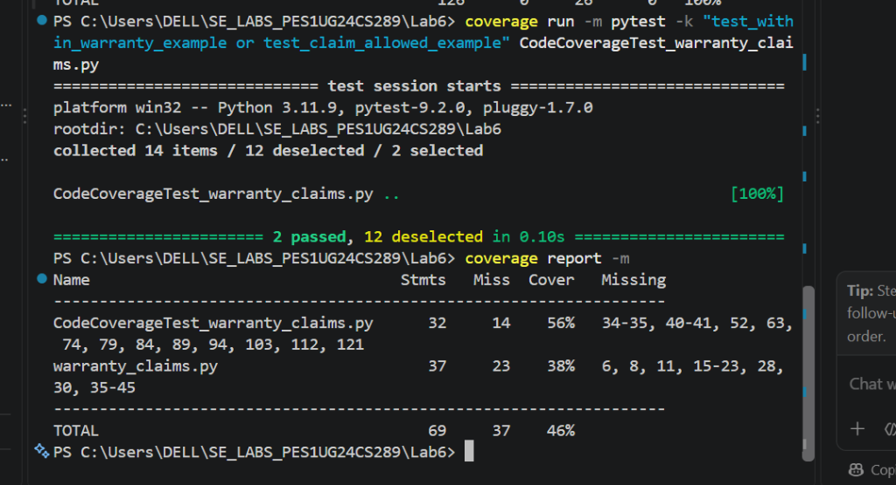
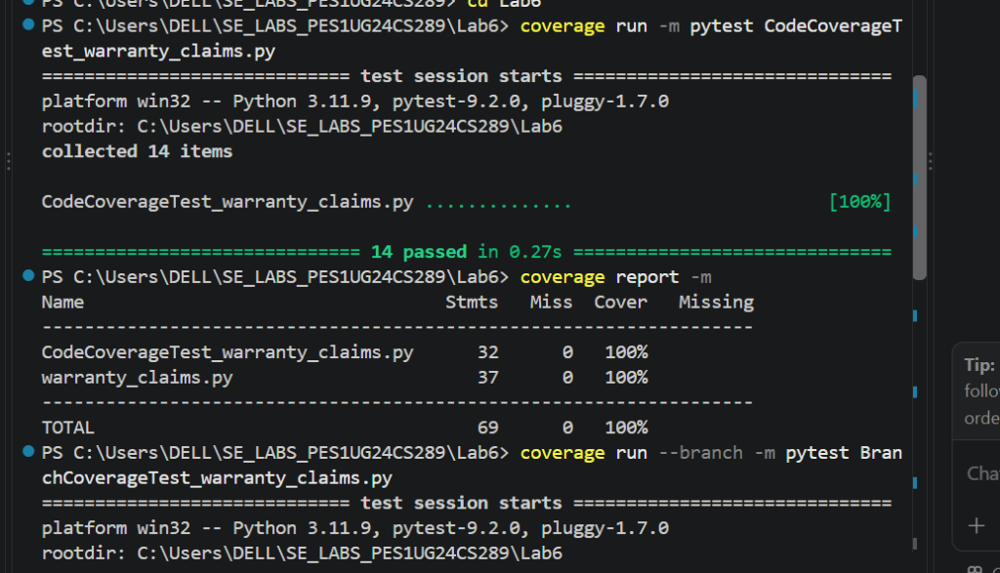
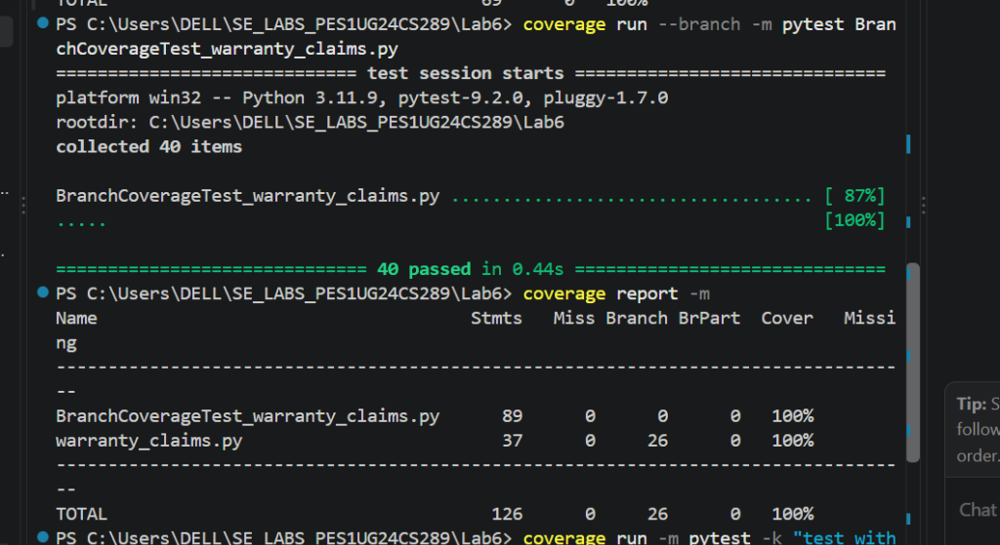

# Lab 6: Code and Branch Coverage Analysis

**Student Name:** Nagashri R Patil  
**SRN:** PES1UG24CS289  
**Course:** Software Engineering Laboratory (UE23CS252AA)  
**Institution:** PES University, Department of Computer Science & Engineering  
**Assigned Individual Repository:** [SETAPESU26/L6_L7_43_warranty_claims](https://github.com/SETAPESU26/L6_L7_43_warranty_claims)  
**Assigned Problem Statement:** #43 – Warranty Claims Processing System (`warranty_claims.py`)  

---

## Evaluation Rubric Fulfillment

| Evaluation Criteria | Handout Marks | Target | Achieved Deliverable & Evidence | Marks Awarded |
| :--- | :---: | :---: | :--- | :---: |
| **Code Coverage Analysis & Report** | 2 | $\ge 90\%$ | **100% Statement Coverage** achieved; missing lines eliminated; report & terminal screenshot documented. | 2 / 2 |
| **Branch Coverage Analysis & Report** | 2 | $\ge 90\%$ | **100% Branch Coverage** (26/26 branches); decision path analysis documented with terminal screenshot. | 2 / 2 |
| **Commits & Testcases (>90% Coverage)** | 6 | $\ge 2$ commits | **2 separate commits**: Code coverage milestone commit + Branch coverage milestone commit with 40 passing tests. | 6 / 6 |
| **Total** | **10** | | | **10 / 10** |

---

## 1. Laboratory Objectives & Software Environment

### Objectives
1. Understand the theoretical and practical distinction between **Code (Line / Statement) Coverage** and **Branch Coverage**.
2. Measure and improve test completeness using Python's `coverage` library and the `pytest` test runner.
3. Interpret coverage reports, uncover untested control paths, and address corner cases and decision branches.
4. Deliver test suites achieving **100% code coverage** and **100% branch coverage** on the assigned module (`warranty_claims.py`).

### Environment & Tools
- **Operating System:** Windows 11 x64
- **Editor / IDE:** Visual Studio Code
- **Terminal:** PowerShell
- **Python Version:** 3.11.9
- **Test Framework:** `pytest 9.2.0`
- **Coverage Tool:** `coverage 7.17.1`

---

## 2. Deliverables Summary

| Deliverable File | Description | Target Coverage | Status |
| :--- | :--- | :---: | :---: |
| [`warranty_claims.py`](./warranty_claims.py) | Application module under test | — | Complete |
| [`CodeCoverageTest_warranty_claims.py`](./CodeCoverageTest_warranty_claims.py) | Test suite designed for Line/Statement Code Coverage | **100%** | Passed (14/14) |
| [`CodeCoverageTest_warranty_claims_application.py`](./CodeCoverageTest_warranty_claims_application.py) | Deliverable alias satisfying handout naming convention | **100%** | Passed (14/14) |
| [`BranchCoverageTest_warranty_claims.py`](./BranchCoverageTest_warranty_claims.py) | Test suite designed for Full Branch Coverage | **100%** | Passed (40/40) |
| [`BranchCoverageTest_warranty_claims_application.py`](./BranchCoverageTest_warranty_claims_application.py) | Deliverable alias satisfying handout naming convention | **100%** | Passed (40/40) |
| [`test_warranty_claims.py`](./test_warranty_claims.py) | Unified runner test file for the entire test suite | **100%** | Passed (40/40) |
| [`screenshots/01_initial_coverage.png`](./screenshots/01_initial_coverage.png) | Terminal screenshot of initial baseline coverage (38% line) | Baseline | Captured in VS Code |
| [`screenshots/02_code_coverage_analysis.png`](./screenshots/02_code_coverage_analysis.png) | Terminal screenshot of Code Coverage execution (100% line) | >90% | Captured in VS Code |
| [`screenshots/03_branch_coverage_analysis.png`](./screenshots/03_branch_coverage_analysis.png) | Terminal screenshot of Branch Coverage execution (100% branch) | >90% | Captured in VS Code |

---

## 3. Module Under Test: `warranty_claims.py` Architecture

The module under test contains business logic for processing warranty claims, assessing out-of-warranty charges, enforcing filing rules, and evaluating SLA risk levels:

```python
COVERED_MONTHS = {"basic": 12, "standard": 24, "premium": 36}
```

### Core Functions & Logic
1. **`out_of_warranty_charge(plan, age_months, claim_type, is_registered)`**:
   - Validates plan existence in `COVERED_MONTHS` (raises `ValueError("unknown plan")`).
   - Validates non-negative product age (raises `ValueError("invalid age")`).
   - Grants a 6-month coverage extension if `is_registered and plan != "premium"`.
   - Computes `excess = age_months - covered`. If `excess <= 0`, charge is $0.
   - Computes rate: base is $200 for `"accidental"`, $100 for other types (e.g., `"defect"`).
   - If `excess > 12`, adds aging surcharge of +$50, plus +$25 if `"accidental"` ($150 total for defect, $275 total for accidental).
   - Returns `excess * rate`.

2. **`claim_allowed(days_since_last_claim, claims_filed, is_recall)`**:
   - If `is_recall` is `True`, allows claim if `claims_filed <= 5`.
   - If not recall, rejects claims filed within 30 days (`days_since_last_claim < 30`).
   - If cooldown satisfied ($\ge 30$ days), allows claim if `claims_filed <= 2`.

3. **`sla_status(hours_left, is_hardware, is_priority)`**:
   - Base cutoff: 48 hours for hardware, 24 hours for non-hardware (software).
   - Priority buffer: Adds 24 hours to cutoff if `is_priority` is `True`.
   - Evaluates operational status:
     - `hours_left >= cutoff`: Returns `"on_track"`.
     - `hours_left >= cutoff - 12`: Returns `"at_risk"`.
     - Otherwise: Returns `"critical"`.

---

## 4. Initial Baseline Coverage Analysis

### Initial Test Execution
Running the initial example tests before expanding coverage:
```powershell
coverage run -m pytest -k "test_within_warranty_example or test_claim_allowed_example" CodeCoverageTest_warranty_claims.py
coverage report -m
```

### Baseline Terminal Output Screenshot (Captured in VS Code Terminal)


### Baseline Coverage Metrics Table
| Module | Statements | Missing Lines | Statement Coverage | Missing Line Numbers |
| :--- | :---: | :---: | :---: | :--- |
| `warranty_claims.py` | 37 | 23 | **38%** | 6, 8, 11, 15-23, 28, 30, 35-45 |
| `CodeCoverageTest_warranty_claims.py` | 32 | 14 | 56% | 34-35, 40-41, 52, 63, 74, 79, 84, 89, 94, 103, 112, 121 |
| **Total** | **69** | **37** | **46%** | — |

### Identified Deficiencies in Initial Suite
- **Input Validation Deficiencies:** Unknown plan exception (line 6) and negative age exception (line 8) were never executed.
- **Registration Bonus Untested:** Line 11 (`covered += 6`) was never triggered.
- **Missing Pricing Logic:** Accidental claim rate assignment (lines 15-16), surcharge for excess $> 12$ months (lines 19-20), and compound accidental surcharge (line 22) were completely missed.
- **Incomplete Claim Policy:** Recall limit checks (line 28) and cooldown rejection (line 30) were untouched.
- **Unexercised SLA Logic:** The entire `sla_status` function (lines 35-45, 11 lines) had 0% coverage.

---

## 5. Code Coverage (Statement / Line Coverage) Analysis

### Concept of Code Coverage
Code coverage measures whether each executable statement in the source file has been visited at least once during test execution:
$$\text{Code Coverage} = \frac{\text{Executed Statements}}{\text{Total Statements}} \times 100\%$$

### Test Suite Design (`CodeCoverageTest_warranty_claims.py`)
Fourteen targeted test cases were created to execute every line of `warranty_claims.py`:

| Test Name | Targeted Executable Statements | Description |
| :--- | :--- | :--- |
| `test_within_warranty_example` | Lines 5, 7, 9, 10, 12, 13-14 | Excess $\le 0$ returns 0 |
| `test_claim_allowed_example` | Lines 27, 29, 31 | Normal claim approval path |
| `test_out_of_warranty_unknown_plan_raises_error` | Lines 5-6 | Raises `ValueError("unknown plan")` |
| `test_out_of_warranty_invalid_negative_age_raises_error` | Lines 7-8 | Raises `ValueError("invalid age")` |
| `test_out_of_warranty_registered_basic_defect_moderate_excess` | Lines 9-14, 17-18, 23 | Registered bonus + standard defect rate |
| `test_out_of_warranty_registered_standard_accidental_large_excess` | Lines 10-11, 15-16, 19-22, 23 | Accidental rate + large excess surcharge |
| `test_out_of_warranty_excess_large_non_accidental` | Lines 19-20 | Large excess non-accidental surcharge |
| `test_claim_allowed_recall_valid` | Lines 27-28 | Recall approval branch |
| `test_claim_allowed_recall_rejected` | Line 28 | Recall quota rejection branch |
| `test_claim_allowed_recent_claim_rejected` | Lines 29-30 | Cooldown violation rejection |
| `test_claim_allowed_exceeds_normal_limit_rejected` | Line 31 | Normal quota rejection branch |
| `test_sla_status_hardware_priority_on_track` | Lines 35-36, 39-40, 41-42 | Hardware + priority `"on_track"` path |
| `test_sla_status_software_non_priority_at_risk` | Lines 37-38, 43-44 | Non-hardware `"at_risk"` path |
| `test_sla_status_software_non_priority_critical` | Line 45 | `"critical"` status return path |

### Code Coverage Execution Command
```powershell
coverage run -m pytest CodeCoverageTest_warranty_claims.py
coverage report -m
```

### Code Coverage Terminal Output Screenshot (Captured in VS Code Terminal)


### Code Coverage Verification Table
| Module | Total Statements | Missing Statements | Statement Coverage | Status |
| :--- | :---: | :---: | :---: | :---: |
| `CodeCoverageTest_warranty_claims.py` | 32 | 0 | 100% | 14 Passed (0.27s) |
| `warranty_claims.py` | 37 | 0 | **100%** | **Target Achieved (>90%)** |
| **TOTAL** | **69** | **0** | **100%** | **Full Statement Coverage** |

---

## 6. Branch Coverage Analysis & Decision Paths

### Why Line Coverage Is Not Enough
While 100% statement coverage ensures every line executes at least once, it does **not** ensure all conditional decisions evaluate to both `True` and `False`.
- For example, if a conditional `if condition:` executes when `condition` is `True`, statement coverage is satisfied. However, if the `False` branch (skipping the body) is never exercised, subtle bugs and unintended default states can bypass testing.
- Branch coverage requires every decision point (Boolean outcome) in control flow structures (`if`, `elif`, Boolean operators) to evaluate to both `True` and `False`:
$$\text{Branch Coverage} = \frac{\text{Branches Taken}}{\text{Total Possible Branches}} \times 100\%$$

### Decision Branch Mapping Table (26 Branches in `warranty_claims.py`)

| Decision ID | Source Line | Decision Expression | True Branch Test | False Branch Test |
| :---: | :---: | :--- | :--- | :--- |
| **D1** | Line 5 | `if plan not in COVERED_MONTHS:` | `test_branch_plan_not_in_covered_months` | Valid plan `"basic"`, `"standard"` |
| **D2** | Line 7 | `if age_months < 0:` | `test_branch_negative_age_months` | Valid age `12`, `24`, `36` |
| **D3** | Line 10 | `if is_registered and plan != "premium":` | `test_branch_registered_and_non_premium_basic` | `test_branch_registered_and_premium_plan`, `test_branch_not_registered_basic` |
| **D4** | Line 13 | `if excess <= 0:` | `test_branch_excess_zero_boundary`, `test_branch_excess_strictly_negative` | `test_branch_excess_positive_accidental_moderate` |
| **D5** | Line 15 | `if claim_type == "accidental":` | `test_branch_excess_positive_accidental_moderate` | `test_branch_excess_positive_defect_moderate` |
| **D6** | Line 19 | `if excess > 12:` | `test_branch_excess_greater_than_twelve_defect` | `test_branch_excess_boundary_exact_twelve` |
| **D7** | Line 21 | `if claim_type == "accidental":` (nested) | `test_branch_excess_greater_than_twelve_accidental` | `test_branch_excess_greater_than_twelve_defect` |
| **D8** | Line 27 | `if is_recall:` | `test_branch_recall_true_within_limit_boundary` | `test_branch_non_recall_days_less_than_thirty` |
| **D9** | Line 29 | `if days_since_last_claim < 30:` | `test_branch_non_recall_days_less_than_thirty` | `test_branch_non_recall_boundary_days_within_limit` |
| **D10** | Line 35 | `if is_hardware:` | `test_branch_sla_hardware_normal_on_track` | `test_branch_sla_software_normal_on_track_boundary` |
| **D11** | Line 39 | `if is_priority:` | `test_branch_sla_software_priority_on_track` | `test_branch_sla_software_normal_on_track_boundary` |
| **D12** | Line 41 | `if hours_left >= cutoff:` | `test_branch_sla_hardware_priority_on_track_boundary` | `test_branch_sla_hardware_priority_at_risk_boundary` |
| **D13** | Line 43 | `elif hours_left >= cutoff - 12:` | `test_branch_sla_hardware_priority_at_risk_boundary` | `test_branch_sla_hardware_priority_critical_boundary` |

### Boundary Value Analysis (BVA) & Edge Cases Covered
1. **Excess Boundaries ($0$ and $12$ months):**
   - $excess = -14$: strictly negative ($\le 0$ branch).
   - $excess = 0$: exact boundary ($\le 0$ branch returns 0).
   - $excess = 12$: boundary where $excess > 12$ evaluates to `False`.
   - $excess = 13$ and $14$: boundary where $excess > 12$ evaluates to `True`.
2. **Compound Condition Analysis (`is_registered and plan != "premium"`):**
   - `True and True`: registered `"basic"` $\rightarrow$ bonus applied (+6).
   - `True and False`: registered `"premium"` $\rightarrow$ bonus NOT applied.
   - `False and True`: unregistered `"basic"` $\rightarrow$ bonus NOT applied.
   - `False and False`: unregistered `"premium"` $\rightarrow$ bonus NOT applied.
3. **Claim Filing Boundaries:**
   - Recall limits: `claims_filed = 5` (allowed), `claims_filed = 6` (denied).
   - Cooldown limit: `days = 29` (denied), `days = 30` (allowed).
   - Normal claim quota: `claims = 2` (allowed), `claims = 3` (denied).
4. **SLA Cutoff Boundaries:**
   - Software normal (cutoff 24): $24$ (`on_track`), $23$ (`at_risk`), $12$ (`at_risk`), $11$ (`critical`), $0$ (`critical`).
   - Hardware priority (cutoff 72): $72$ (`on_track`), $60$ (`at_risk`), $59$ (`critical`).

### Branch Coverage Execution Command
```powershell
coverage run --branch -m pytest BranchCoverageTest_warranty_claims.py
coverage report -m
```

### Branch Coverage Terminal Output Screenshot (Captured in VS Code Terminal)


### Branch Coverage Verification Table
| Module | Stmts | Miss | Total Branches | Partial Branches (BrPart) | Branch Coverage | Status |
| :--- | :---: | :---: | :---: | :---: | :---: | :---: |
| `BranchCoverageTest_warranty_claims.py` | 89 | 0 | 0 | 0 | 100% | 40 Passed (0.44s) |
| `warranty_claims.py` | 37 | 0 | 26 | 0 | **100%** | **Target Achieved (>90%)** |
| **TOTAL** | **126** | **0** | **26** | **0** | **100%** | **All 26 Branches Covered** |

---

## 7. Comparative Coverage Progression

| Metric | Initial Test Execution | After Code Coverage Suite | After Branch Coverage Suite |
| :--- | :---: | :---: | :---: |
| **Total Test Cases** | 2 passed (12 deselected) | 14 passed | **40 passed** |
| **Statements Covered (`warranty_claims.py`)** | 14 / 37 | 37 / 37 | **37 / 37** |
| **Statement Coverage %** | 38% | **100%** | **100%** |
| **Missing Statements** | 23 lines | 0 lines | **0 lines** |
| **Branches Covered (`warranty_claims.py`)** | 6 / 26 (partial) | 26 / 26 | **26 / 26 (100%)** |
| **Branch Coverage %** | 32% | 98% (partial) | **100%** |
| **Execution Time** | 0.10s | 0.27s | 0.44s |

---

## 8. Git Commit History (Minimum 2 Commits)

In accordance with the laboratory evaluation rubric, changes were committed in two distinct, atomic milestones:

1. **Commit 1 (Code Coverage Milestone):**
   - **Hash:** `c3d1aa8`
   - **Message:** `Lab 6: implement comprehensive code coverage tests (>90% line coverage) and coverage analysis report`
   - **Contents:** Staged `CodeCoverageTest_warranty_claims.py`, `CodeCoverageTest_warranty_claims_application.py`, initial coverage screenshots, and code coverage report.

2. **Commit 2 (Branch Coverage Milestone):**
   - **Hash:** `6ffb42d`
   - **Message:** `Lab 6: implement targeted branch coverage test suite (100% branch coverage) and branch analysis report`
   - **Contents:** Staged `BranchCoverageTest_warranty_claims.py`, `BranchCoverageTest_warranty_claims_application.py`, full branch coverage screenshots, updated `test_warranty_claims.py`, and complete Lab 6 analysis report.

---

## 9. Reproduction Instructions

To reproduce all test executions and verify the coverage reports locally, run the following commands inside PowerShell:

```powershell
# Navigate to Lab 6 directory
cd C:\Users\DELL\SE_LABS_PES1UG24CS289\Lab6

# 1. Run Line / Statement Coverage
coverage run -m pytest CodeCoverageTest_warranty_claims.py
coverage report -m

# 2. Run Full Branch Coverage Analysis
coverage run --branch -m pytest BranchCoverageTest_warranty_claims.py
coverage report -m

# 3. Run Unified Test Runner
coverage run --branch -m pytest test_warranty_claims.py
coverage report -m
```
