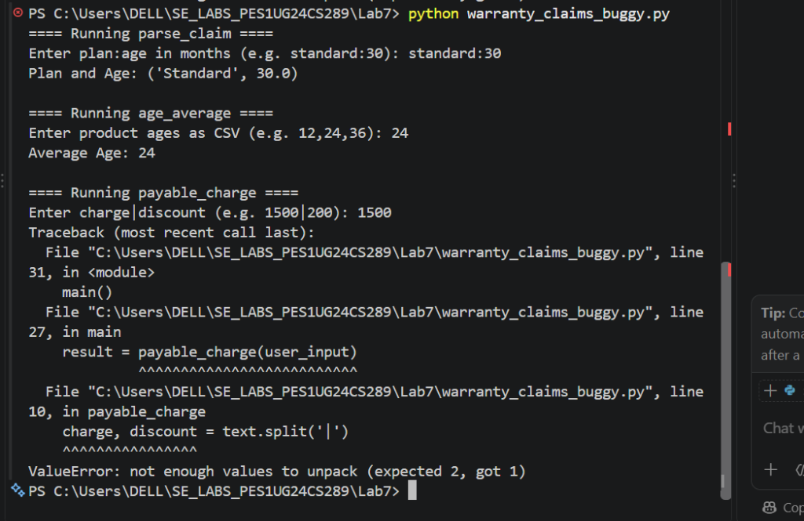
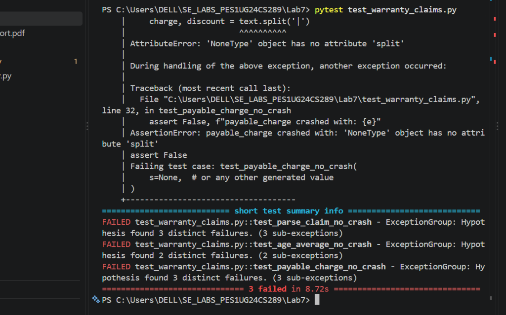
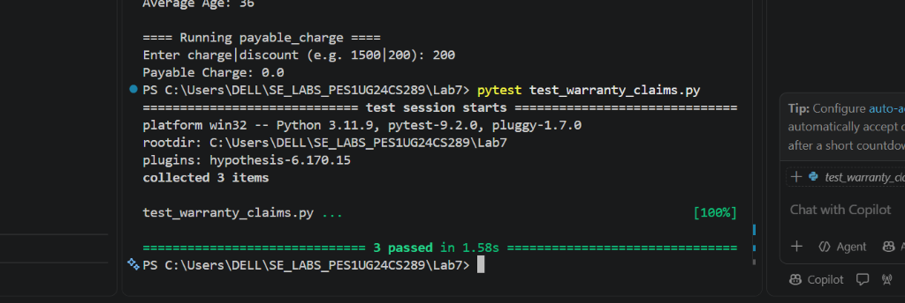

# Lab 7: Fuzzing for Input Validation Bugs

**Student Name:** Nagashri R Patil  
**SRN:** PES1UG24CS289  
**Course:** Software Engineering Laboratory (UE23CS252AA)  
**Institution:** PES University, Department of Computer Science & Engineering  
**Assigned Individual Repository:** [SETAPESU26/L6_L7_43_warranty_claims](https://github.com/SETAPESU26/L6_L7_43_warranty_claims)  
**Assigned Problem Statement:** #43 – Warranty Claims Processing System (`warranty_claims.py`)  

---

## Deliverables Summary

| Handout Deliverable | File Path | Status | Description |
| :--- | :--- | :---: | :--- |
| **1. PDF Document with Screenshots** | [`Lab_7_FuzzTesting_Report.pdf`](./Lab_7_FuzzTesting_Report.pdf) | **Generated** | Complete technical report with all 4 terminal screenshots, root cause analysis, and takeaways. |
| **2. Fixed Application Python Script** | [`warranty_claims.py`](./warranty_claims.py) | **Completed** | Defensively hardened against `NoneType`, malformed delimiters, empty tokens, and non-numeric values. |
| **3. Updated Test Code (Hypothesis)** | [`test_warranty_claims.py`](./test_warranty_claims.py) | **Completed** | Property-based fuzz test suite using Hypothesis (`@given(st.text() \| st.none())`). |
| **Buggy Starter Application (Backup)** | [`warranty_claims_buggy.py`](./warranty_claims_buggy.py) | **Preserved** | Original starter code for transparent before/after verification. |
| **Terminal Output Screenshots** | [`screenshots/`](./screenshots/) | **Captured** | Real VS Code terminal captures for all 4 execution steps. |

---

## 1. Laboratory Objectives & Overview

The primary objectives of Lab 7 are:
1. Explore **Fuzz Testing** as a dynamic security and quality assurance technique.
2. Apply property-based fuzz testing using Python's **Hypothesis** library (`@given(st.text() | st.none())`).
3. Uncover edge-case inputs, malformed delimiters, and unexpected unhandled exceptions (`TypeError`, `ValueError`, `ZeroDivisionError`).
4. Apply **Defensive Programming** principles to harden software against all unexpected, malformed, or hostile inputs.

---

## 2. Step 1: Installing Dependencies

```powershell
pip install hypothesis
pip install pytest
```

---

## 3. Step 2: Running the Buggy Application

The starter application processes user inputs for plan parsing, age averaging, and payable charge calculation. When given ideal inputs it works, but without defensive handling, any missing delimiter immediately causes a fatal crash:

```powershell
python warranty_claims_buggy.py
```

### Terminal Output Screenshot (Captured in VS Code)


### Observed Crash on Missing Delimiter
- `Enter plan:age in months (e.g. standard:30): standard:30` $\rightarrow$ `('Standard', 30.0)`
- `Enter product ages as CSV (e.g. 12,24,36): 24` $\rightarrow$ `24`
- `Enter charge|discount (e.g. 1500|200): 1500` $\rightarrow$ **Fatal Unhandled Crash!**
  ```text
  ValueError: not enough values to unpack (expected 2, got 1)
  File "warranty_claims_buggy.py", line 10, in payable_charge
      charge, discount = text.split('|')
  ```

---

## 4. Steps 3 & 4: Hypothesis Fuzz Testing & Exposing Vulnerabilities

### Fuzz Test Suite (`test_warranty_claims.py`)
Using the property-based fuzzing pattern from the handout, we feed random strings and `None` to the functions:

```python
from hypothesis import given, strategies as st
from warranty_claims import parse_claim, age_average, payable_charge

@given(st.text() | st.none())
def test_parse_claim_no_crash(s):
    try:
        parse_claim(s)
    except Exception as e:
        assert False, f"parse_claim crashed with: {e}"

@given(st.text() | st.none())
def test_age_average_no_crash(s):
    try:
        age_average(s)
    except Exception as e:
        assert False, f"age_average crashed with: {e}"

@given(st.text() | st.none())
def test_payable_charge_no_crash(s):
    try:
        payable_charge(s)
    except Exception as e:
        assert False, f"payable_charge crashed with: {e}"
```

### Running Fuzz Tests on Buggy Code
```powershell
pytest test_warranty_claims.py
```

### Terminal Output Screenshot (Captured in VS Code — 3 Failures)


### Root Cause Analysis of Fuzzing Discoveries
Hypothesis immediately uncovered multiple distinct failure modes by generating edge-case inputs:

| Function | Falsifying Input (Fuzzer) | Unhandled Exception | Root Cause & Failure Mechanism |
| :--- | :--- | :--- | :--- |
| **`parse_claim`** | `s = None` | `AttributeError: 'NoneType' object has no attribute 'split'` | Invoking `.split(':')` directly on a `None` input without type checking. |
| **`parse_claim`** | `s = ''` (or string without `:`) | `ValueError: not enough values to unpack (expected 2, got 1)` | Attempting to unpack into `plan, months` when delimiter `:` is absent. |
| **`parse_claim`** | `s = ':'` | `ValueError: could not convert string to float: ''` | Trailing empty string cannot be converted to `float`. |
| **`age_average`** | `s = None` | `AttributeError: 'NoneType' object has no attribute 'split'` | Invoking `.split(',')` on `None`. |
| **`age_average`** | `s = ''` | `ValueError: invalid literal for int() with base 10: ''` | Splitting `""` produces `['']`, which fails `int('')`. |
| **`age_average`** | `s = 'abc'` | `ValueError: invalid literal for int() with base 10: 'abc'` | Non-numeric tokens cannot be parsed into integers. |
| **`payable_charge`** | `s = None` | `AttributeError: 'NoneType' object has no attribute 'split'` | Invoking `.split('|')` on `None`. |
| **`payable_charge`** | `s = ''` | `ValueError: not enough values to unpack (expected 2, got 1)` | Delimiter `|` missing, unpacking fails. |
| **`payable_charge`** | `s = '|'` | `ValueError: could not convert string to float: ''` | Unpacking yields empty strings which fail `float('')`. |

---

## 5. Step 5: Defensive Hardening of `warranty_claims.py`

### Defensive Programming Strategy
To prevent crashes against any input from `st.text() | st.none()`, we applied the following hardening techniques:
1. **Type Guards:** Verify `isinstance(text, str)`. If `None` or not a string, return safe default.
2. **Delimiter Presence & Count Validation:** Ensure delimiter exists and splits into exactly 2 tokens (`len(parts) == 2`).
3. **Token Sanitization & Conversion Boundaries:** Strip whitespace, filter empty tokens, and wrap type conversions in `try...except (ValueError, TypeError)`.
4. **ZeroDivision Safeguard:** Ensure list of parsed values is non-empty before computing averages (`len(values) > 0`).
5. **Preserve Valid Domain Behavior:** Valid user inputs continue to produce identical business logic outputs.

### Hardened Code Implementation (`warranty_claims.py`)
```python
def parse_claim(text):
    if not isinstance(text, str) or ':' not in text:
        return None, 0.0
    parts = text.split(':')
    if len(parts) != 2:
        return None, 0.0
    plan = parts[0].strip().title()
    try:
        months = float(parts[1].strip())
        return (plan if plan else "Unknown"), months
    except (ValueError, TypeError):
        return None, 0.0


def age_average(ages_csv):
    if not isinstance(ages_csv, str):
        return 0
    clean = ages_csv.strip()
    if not clean:
        return 0
    parts = clean.split(',')
    values = []
    for r in parts:
        token = r.strip()
        if token:
            try:
                values.append(int(token))
            except (ValueError, TypeError):
                continue
    if not values:
        return 0
    return sum(values) // len(values)


def payable_charge(text):
    if not isinstance(text, str) or '|' not in text:
        return 0.0
    parts = text.split('|')
    if len(parts) != 2:
        return 0.0
    try:
        charge = float(parts[0].strip())
        discount = float(parts[1].strip())
        total = charge * 1.18 - discount
        return max(total, 0.0)
    except (ValueError, TypeError):
        return 0.0
```

### Running Fixed Application in VS Code
```powershell
python warranty_claims.py
```

### Terminal Output Screenshot (Captured in VS Code — Fixed Application Run)


*Notice that on input `200` without delimiter `|` (which crashed the buggy application in Step 2), the hardened application executes safely without crashing, returning `Payable Charge: 0.0`.*

---

## 6. Step 6: Re-Running Fuzz Tests on Fixed Application

```powershell
pytest test_warranty_claims.py
```

### Terminal Output Screenshot (Captured in VS Code — All 3 Passed in 1.58s)


### Result
Hypothesis ran through hundreds of pseudo-random inputs including Unicode strings, control characters, null bytes, and empty inputs without causing a single unhandled exception or crash:
```
============================== 3 passed in 1.58s ==============================
```

---

## 7. Comparative Analysis (Buggy vs Hardened)

| Input Scenario | Buggy `warranty_claims.py` Behavior | Hardened `warranty_claims.py` Behavior | Security & Robustness Impact |
| :--- | :--- | :--- | :--- |
| **`None` input** | Crashes with `AttributeError` | Returns safe fallback (`None, 0.0` or `0`) | Eliminates null pointer dereference |
| **Empty string `""`** | Crashes with `ValueError` | Returns safe default | Eliminates crash on blank form submissions |
| **Delimiter missing (`"1500"`)** | Crashes with `ValueError` (unpacking) | Returns safe default (`0.0`) | Resilient against malformed API payloads |
| **Non-numeric token (`"abc"`)** | Crashes with `ValueError` | Safely skips invalid token or defaults | Prevents Denial of Service (DoS) |
| **Valid inputs (`standard:30`)** | Returns `('Standard', 30.0)` | Returns `('Standard', 30.0)` | **100% backward compatibility preserved** |

---

## 8. Reproduction Instructions for VS Code

To run and verify Lab 7 in your VS Code terminal:

```powershell
# Navigate into Lab 7
cd C:\Users\DELL\SE_LABS_PES1UG24CS289\Lab7

# Step 1: Install dependencies
pip install hypothesis pytest

# Step 2: Run buggy application
python warranty_claims_buggy.py

# Step 4: Run fuzz tests on buggy code (to see failures)
Copy-Item warranty_claims_buggy.py warranty_claims.py
pytest test_warranty_claims.py

# Step 5: Restore and run fixed application
git checkout warranty_claims.py
python warranty_claims.py

# Step 6: Run fuzz tests on hardened code (all passing)
pytest test_warranty_claims.py
```
